# Network Fundamentals Lab

**Project Name:** Network-Fundamentals-Lab  
**Author:** Nicholas Williams  
**Date Created:** October 16th, 2026  
**Last Updated:** October 26th, 2026  
**Platform:** Cisco Modeling Labs (IOSv / IOSvL2, Linux hosts)  
**Status:** Completed

---

# 1. Objectives

Build a three-tier campus network (access, distribution, core) with an edge router to an ISP, end to end:

- Configure VLANs, access ports, voice VLAN, and trunks.
- Bundle links with LACP (distribution) and static EtherChannel (core).
- Tune Rapid PVST+: root bridge placement, PortFast, BPDU Guard, and timers.
- Design an efficient IPv4 VLSM plan and an IPv6 plan for VLANs, loopbacks, and point-to-point links.
- Route IPv4 and IPv6 with OSPF (area 0) and default routes toward the ISP.
- Provide HSRP, DHCP, NAT, and NTP services.
- Apply security controls: banners, port security, an extended ACL, and SSH-only management.
- Configure syslog, CDP, and LLDP for network management.

---

# 2. Network Overview

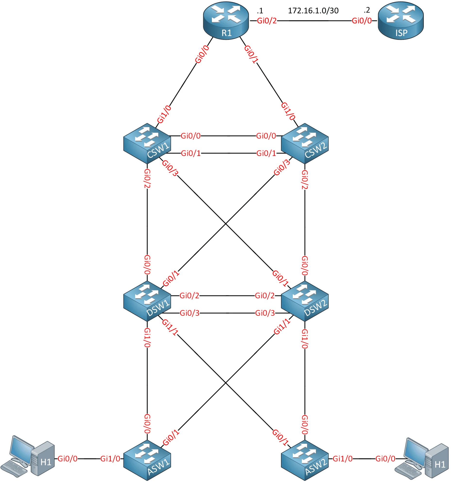

| Layer | Devices | Role |
|---|---|---|
| Edge | R1 | Router to ISP, DHCP server, NAT, NTP source |
| Core | CSW1, CSW2 | Layer 3 core switches, static EtherChannel between them |
| Distribution | DSW1, DSW2 | Layer 3 SVIs for all VLANs, HSRP, LACP EtherChannel between them |
| Access | ASW1, ASW2 | Layer 2 access switches for hosts and phones |
| Hosts | H1, H2 | Linux hosts in VLAN 10 |
| ISP | ISP | Upstream router (not modified); hosts the 1.1.1.1 server |

### VLANs

| VLAN | Name | Max devices |
|---|---|---|
| 10 | CLIENTS | 100 |
| 20 | VOICE | 40 |
| 30 | PRINTERS | 12 |
| 40 | MANAGEMENT | 6 |

---

# 3. LAN Switching

## Create VLANs
On DSW1, DSW2, ASW1, and ASW2:

```bash
vlan 10
 name CLIENTS
vlan 20
 name VOICE
vlan 30
 name PRINTERS
vlan 40
 name MANAGEMENT
```

## Access Ports
H1 and H2 connect to GigabitEthernet1/0 on their access switch and belong to VLAN 10:

```bash
interface g1/0
 switchport mode access
 switchport access vlan 10
```

GigabitEthernet0/2 on ASW1 is prepared for a computer in VLAN 10 with an IP phone in VLAN 20:

```bash
interface g0/2
 switchport mode access
 switchport access vlan 10
 switchport voice vlan 20
```

## Trunks
The access layer negotiates the trunk dynamically:

```bash
interface range g0/0-1
 switchport trunk encapsulation negotiate
 switchport mode dynamic desirable
```

The distribution layer builds the trunk statically:

```bash
interface range g1/0-1
 switchport trunk encapsulation dot1q
 switchport mode trunk
```

## Distribution EtherChannel (LACP)
The links between DSW1 and DSW2 are bundled with a negotiation protocol. Company policy rules out proprietary protocols (PAgP), so LACP is used. DSW1 actively negotiates and DSW2 only responds.

DSW1:
```bash
interface range g0/2-3
 switchport trunk encapsulation dot1q
 switchport mode trunk
 channel-group 1 mode active
```

DSW2:
```bash
interface range g0/2-3
 switchport trunk encapsulation dot1q
 switchport mode trunk
 channel-group 1 mode passive
```

`show etherchannel summary` — Po1 is up as a Layer 2 LACP bundle:

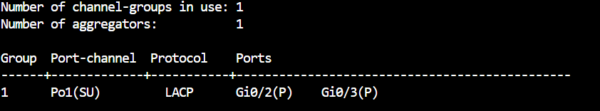

## Core EtherChannel (static)
The links between CSW1 and CSW2 are bundled with no negotiation protocol, as a routed (Layer 3) port-channel:

```bash
interface range g0/0-1
 no switchport
 channel-group 1 mode on
```

Po1 is up as a Layer 3 bundle (`RU`) with no protocol:

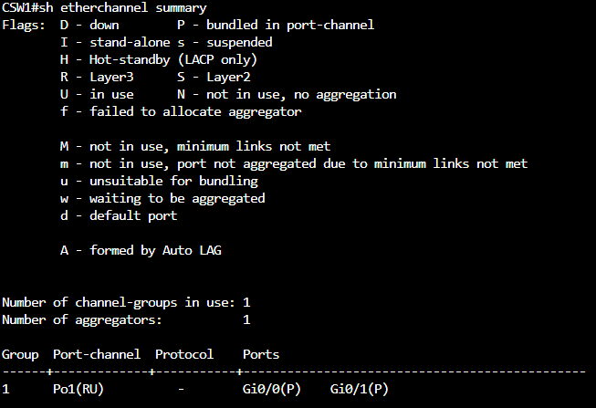

## Spanning Tree
Use the fastest option that still calculates a tree per VLAN — Rapid PVST+:

```bash
spanning-tree mode rapid-pvst
```

DSW1 is the root bridge for every VLAN, and DSW2 takes over if DSW1 fails.

DSW1:
```bash
spanning-tree vlan 1,10,20,30,40 priority 0
```

DSW2:
```bash
spanning-tree vlan 1,10,20,30,40 root secondary
```

DSW1 holds priority 0 for every VLAN:

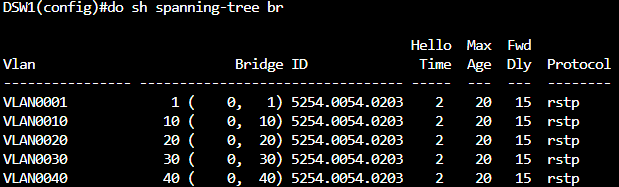

DSW2 holds priority 28672 as the secondary root:

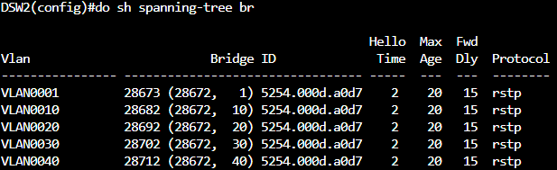

### PortFast
Hosts boot in seconds and should forward traffic immediately instead of waiting on convergence. On the access switches:

```bash
spanning-tree portfast default
```

### BPDU Guard
To stop a malicious host from influencing spanning tree, an edge port that receives a BPDU goes down immediately and recovers on its own after 10 minutes:

```bash
spanning-tree portfast edge bpduguard default
errdisable recovery cause bpduguard
errdisable recovery interval 600
```

ASW1 Gi1/0 is in PortFast edge mode with BPDU Guard enabled by default:

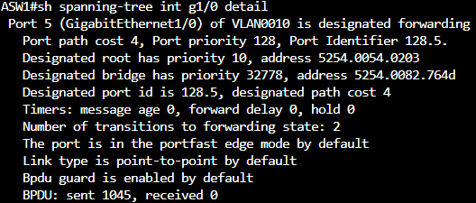

Errdisable recovery for `bpduguard` is enabled with a 600-second timer:

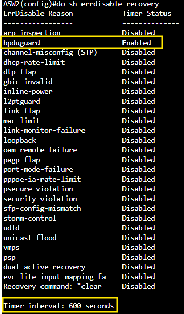

### Timers
Company policy sets custom STP timers: hellos every 3 seconds, a 10-second forward delay, and a 20-second max age.

```bash
spanning-tree vlan 10,20,30,40 hello-time 3
spanning-tree vlan 10,20,30,40 forward-time 10
spanning-tree vlan 10,20,30,40 max-age 20
```

Non-root switches use the timers advertised by the root bridge. To keep these timers in effect no matter which switch becomes root, apply them on **DSW1, DSW2, ASW1, and ASW2**.

---

# 4. IP Addressing

## IPv4
The campus uses `10.0.0.0/8`. Subnets are sized as tightly as possible (VLSM), largest first, since the number of devices per VLAN won't change. Loopbacks and point-to-point links get their own `/24` blocks to leave room for new devices and VLANs.

### VLAN Subnets

| VLAN | Subnet | Usable hosts | Broadcast | DSW1 SVI | DSW2 SVI |
|---|---|---|---|---|---|
| 10 | `10.0.0.0/25` | `.1 – .126` (126) | `10.0.0.127` | `10.0.0.1` | `10.0.0.2` |
| 20 | `10.0.0.128/26` | `.129 – .190` (62) | `10.0.0.191` | `10.0.0.129` | `10.0.0.130` |
| 30 | `10.0.0.192/28` | `.193 – .206` (14) | `10.0.0.207` | `10.0.0.193` | `10.0.0.194` |
| 40 | `10.0.0.208/29` | `.209 – .214` (6) | `10.0.0.215` | `10.0.0.209` | `10.0.0.210` |

- **VLAN 10 HSRP virtual gateway:** `10.0.0.3`
- **VLAN 40 management:** ASW1 `10.0.0.211`, ASW2 `10.0.0.212`

### Loopbacks (`10.0.255.0/24`, one `/32` per device)

| Device | Loopback |
|---|---|
| R1 | `10.0.255.1/32` |
| CSW1 | `10.0.255.2/32` |
| CSW2 | `10.0.255.3/32` |
| DSW1 | `10.0.255.4/32` |
| DSW2 | `10.0.255.5/32` |
| ASW1 | `10.0.255.6/32` |
| ASW2 | `10.0.255.7/32` |

### Point-to-Point Links (`10.0.250.0/24`, one `/30` per link)

| Link | Subnet | Device A | Device B |
|---|---|---|---|
| CSW1 ↔ R1 | `10.0.250.0/30` | CSW1 `10.0.250.1` | R1 `10.0.250.2` |
| CSW1 ↔ DSW1 | `10.0.250.4/30` | CSW1 `10.0.250.5` | DSW1 `10.0.250.6` |
| CSW1 ↔ CSW2 (Po1) | `10.0.250.8/30` | CSW1 `10.0.250.9` | CSW2 `10.0.250.10` |
| CSW2 ↔ R1 | `10.0.250.12/30` | CSW2 `10.0.250.13` | R1 `10.0.250.14` |
| CSW2 ↔ DSW1 | `10.0.250.16/30` | CSW2 `10.0.250.17` | DSW1 `10.0.250.18` |
| CSW1 ↔ DSW2 | `10.0.250.24/30` | CSW1 `10.0.250.25` | DSW2 `10.0.250.26` |
| CSW2 ↔ DSW2 | `10.0.250.28/30` | CSW2 `10.0.250.29` | DSW2 `10.0.250.30` |

### R1 ↔ ISP (`172.16.1.0/30`)

| Device | Address |
|---|---|
| R1 | `172.16.1.1` |
| ISP | `172.16.1.2` (preconfigured, not modified) |

```bash
interface <R1-ISP-interface>
 ip address 172.16.1.1 255.255.255.252
```

## IPv6
The campus uses `2001:db8::/32`. The fourth hextet identifies the network and mirrors the IPv4 plan: the VLAN number for VLANs, `255` for loopbacks, and `250` for point-to-point links.

### VLANs (`/64`)

| VLAN | Prefix | DSW1 | DSW2 | Other |
|---|---|---|---|---|
| 10 | `2001:db8:0:10::/64` | `::1` | `::2` | |
| 20 | `2001:db8:0:20::/64` | `::1` | `::2` | |
| 30 | `2001:db8:0:30::/64` | `::1` | `::2` | |
| 40 | `2001:db8:0:40::/64` | `::1` | `::2` | ASW1 `::3`, ASW2 `::4` |

### Loopbacks (`/128`)

| Device | Loopback |
|---|---|
| R1 | `2001:db8:0:255::1/128` |
| CSW1 | `2001:db8:0:255::2/128` |
| CSW2 | `2001:db8:0:255::3/128` |
| DSW1 | `2001:db8:0:255::4/128` |
| DSW2 | `2001:db8:0:255::5/128` |
| ASW1 | `2001:db8:0:255::6/128` |
| ASW2 | `2001:db8:0:255::7/128` |

### Point-to-Point Links (`/127`)

| Link | R1 | ISP |
|---|---|---|
| R1 ↔ ISP | `2001:db8:0:250::/127` | `2001:db8:0:250::1/127` |

Internal point-to-point links don't need global addresses — OSPFv3 runs over link-local addresses — so they only get `ipv6 enable`:

```bash
interface <internal-p2p-interface>
 ipv6 enable
```

DSW1 has global addresses on its loopback and SVIs, with link-local only on its uplinks:

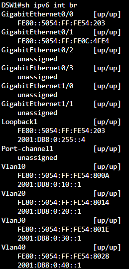

R1 has a global address only on its ISP link (Gi0/2) and its loopback:

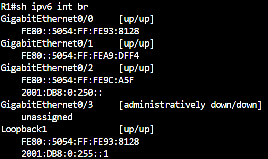

The `/127` link to the ISP is up and the ISP side answers pings:

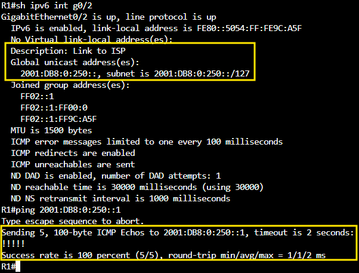

---

# 5. Routing

## IPv4

### Default Route
R1 reaches 1.1.1.1 and anything else behind the ISP with a static default route (the ISP router can't be changed):

```bash
ip route 0.0.0.0 0.0.0.0 172.16.1.2
```

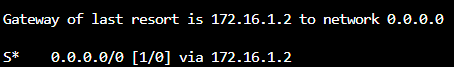

### OSPF
All VLANs, point-to-point links, and loopbacks must be reachable using a non-proprietary, fast-converging link-state protocol (OSPF) in a single area (area 0).

OSPF can be enabled per interface:
```bash
interface <interface>
 ip ospf 1 area 0
```
or with network statements:
```bash
router ospf 1
 network <ip-address> <wildcard> area 0
```

On DSW1 and DSW2, every SVI is advertised:

```bash
interface range Vlan10, Vlan20, Vlan30, Vlan40
 ip ospf 1 area 0
```

The distribution switches shouldn't form unnecessary adjacencies, so the user-facing VLANs are passive:

```bash
router ospf 1
 passive-interface Vlan10
 passive-interface Vlan20
 passive-interface Vlan30
```

The core switches skip the DR/BDR election on their bundle and use fast hello/dead timers (5 s / 15 s):

```bash
interface Port-channel1
 ip ospf network point-to-point
 ip ospf hello-interval 5
 ip ospf dead-interval 15
```

## IPv6

### Default Route
```bash
ipv6 route ::/0 2001:db8:0:250::1
```

### OSPFv3
Each device uses its IPv4 loopback address as the router ID, and everything is in a single area:

```bash
ipv6 unicast-routing
ipv6 router ospf 1
 router-id <ipv4-loopback>

interface <interface>
 ipv6 ospf 1 area 0
```

On DSW1 and DSW2, all SVIs and the loopback are in OSPFv3, with the user VLANs passive to avoid unneeded adjacencies:

```bash
ipv6 router ospf 1
 passive-interface Vlan10
 passive-interface Vlan20
 passive-interface Vlan30
```

R1 advertises its default route into OSPFv3:

```bash
ipv6 router ospf 1
 default-information originate
```

---

# 6. Network Services

## HSRP (VLAN 10)
Users in VLAN 10 lost their gateway whenever DSW1 or DSW2 had stability issues. A virtual gateway, `10.0.0.3`, fixes this. DSW1 is preferred and takes the role back when it recovers.

DSW1:
```bash
interface Vlan10
 standby version 2
 standby 1 ip 10.0.0.3
 standby 1 priority 110
 standby 1 preempt
```

DSW2:
```bash
interface Vlan10
 standby version 2
 standby 1 ip 10.0.0.3
```

DSW1 is Active with priority 110 and preempt:

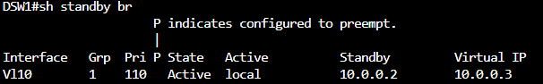

DSW2 is Standby:

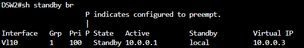

## DHCP
R1 hands out addresses for VLAN 10 and VLAN 20.

VLAN 10 — the HSRP virtual gateway, DNS 1.1.1.1, domain `MYDOMAIN.LOCAL`, and a 48-hour lease:

```bash
ip dhcp pool vlan10
 network 10.0.0.0 255.255.255.128
 default-router 10.0.0.3
 dns-server 1.1.1.1
 domain-name MYDOMAIN.LOCAL
 lease 2
```

VLAN 20 — includes TFTP server `10.0.0.135` (option 150) for the IP phones:

```bash
ip dhcp pool vlan20
 network 10.0.0.128 255.255.255.192
 default-router 10.0.0.129
 option 150 ip 10.0.0.135
```

R1 isn't on the VLANs, so DSW1 and DSW2 relay DHCP requests to it:

```bash
interface Vlan10
 ip helper-address 10.0.250.2
```

To test, H1 and H2 have routing disabled and run a DHCP client on startup:

```bash
ip link set dev eth0 up
dhclient eth0
```

H1 received `10.0.0.4/25`:

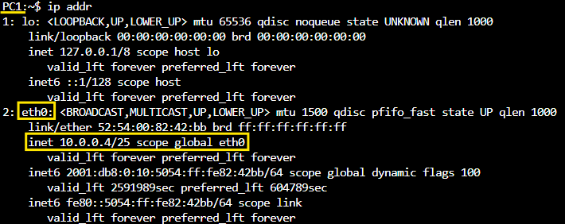

H2 received `10.0.0.5/25`:

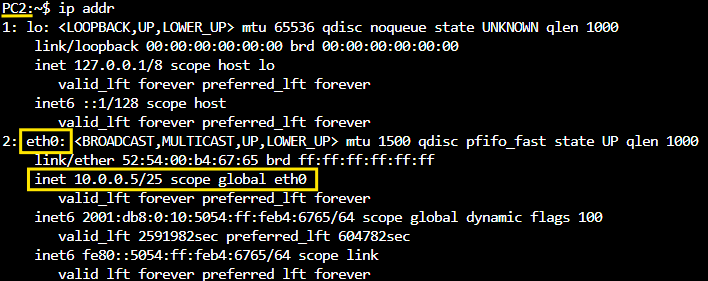

## NAT
All campus switches and hosts need to reach 1.1.1.1. R1 overloads (PAT) the whole `10.0.0.0/8` range onto its ISP-facing address:

```bash
ip access-list standard NAT
 permit 10.0.0.0 0.255.255.255

interface <outside-interface-to-ISP>
 ip nat outside

interface <inside-interface-to-campus>
 ip nat inside

ip nat inside source list NAT interface <outside-interface-to-ISP> overload
```

H1 (`10.0.0.4`) is translated to `172.16.1.1` toward 1.1.1.1:

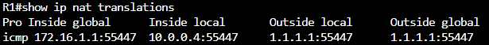

## NTP
Logs were inconsistent across devices, so clocks are synced in a hierarchy that follows the topology.

| Device | NTP servers |
|---|---|
| R1 | `1.1.1.1` |
| CSW1, CSW2 | R1 (`10.0.255.1`) |
| DSW1 | CSW2 (`10.0.255.3`), CSW1 (`10.0.255.2`) |
| DSW2 | CSW1 (`10.0.255.2`), CSW2 (`10.0.255.3`) |
| ASW1 | DSW1 (`10.0.255.4`), DSW2 (`10.0.255.5`) |
| ASW2 | DSW2 (`10.0.255.5`), DSW1 (`10.0.255.4`) |

```bash
ntp server <server-ip>
```

---

# 7. Security

## Banners
R1 shows "Authorized users only" at login:

```bash
username admin secret <password>
line con 0
 login local
banner login #Authorized users only#
```

CSW1 shows a MOTD:

```bash
banner motd #This is CSW1#
```

## Port Security (ASW1 Gi1/0 → H1)
Only one MAC address is allowed, the first one learned is saved, and a violation shuts the port:

```bash
interface g1/0
 switchport port-security
 switchport port-security maximum 1
 switchport port-security mac-address sticky
 switchport port-security violation shutdown
```

## ACL — Block HTTP from VLAN 10
Hosts in VLAN 10 can't reach the HTTP server on 1.1.1.1; all other traffic is allowed. Applied on DSW1 and DSW2, inbound on the VLAN 10 SVI so traffic is filtered as close to the source as possible:

```bash
ip access-list extended BLOCK-V10-HTTP
 deny tcp 10.0.0.0 0.0.0.127 host 1.1.1.1 eq 80
 permit ip any any

interface Vlan10
 ip access-group BLOCK-V10-HTTP in
```

## SSH on CSW1
CSW1 accepts remote management over SSH only, with username `cisco` / password `cisco` (lab credentials). Telnet is blocked and passwords aren't stored in clear text.

```bash
username cisco privilege 15 secret cisco
ip domain-name MYDOMAIN.LOCAL
crypto key generate rsa modulus 2048
ip ssh version 2
service password-encryption

line vty 0 4
 login local
 transport input ssh
```

H1 connects to CSW1's loopback over SSH and sees the "This is CSW1" MOTD. IOSv only offers older key exchange and host key algorithms, so the Linux client has to allow them explicitly:

```bash
ssh -o KexAlgorithms=+diffie-hellman-group14-sha1 -o HostKeyAlgorithms=+ssh-rsa cisco@10.0.255.2
```

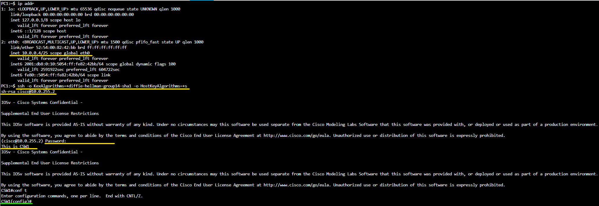

---

# 8. Network Management

## Syslog
DSW1 sends logs to an external syslog server:

```bash
logging 10.0.0.240
```

## CDP
Switches and R1 discover each other with CDP, sending every 5 seconds and discarding entries after 60 seconds:

```bash
cdp timer 5
cdp holdtime 60
```

CDP isn't sent to hosts or the ISP. On those interfaces:

```bash
no cdp enable
```

## LLDP (access switches)
LLDP is turned on, but not used toward the distribution switches (CDP covers those). Toward hosts, the switch listens but doesn't advertise.

```bash
lldp run

interface range g0/0-1
 no lldp transmit
 no lldp receive

interface g1/0
 no lldp transmit
```

Uplinks Gi0/0-1 have Tx and Rx disabled, and host port Gi1/0 only receives:

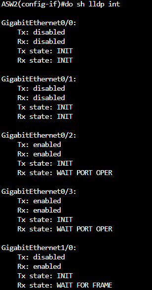

---

# 9. Verification

```bash
show vlan brief
show interfaces trunk
show etherchannel summary
show spanning-tree brief
show spanning-tree interface <int> detail
show errdisable recovery
show ip interface brief
show ipv6 interface brief
show ip route
show ipv6 route
show ip ospf neighbor
show ipv6 ospf neighbor
show standby brief
show ip dhcp binding
show ip nat translations
show ntp associations
show port-security interface g1/0
show access-lists
show cdp neighbors
show lldp interface
```

## Expected Result

- VLANs, trunks, and both EtherChannels are up, and DSW1 is the root bridge for every VLAN with DSW2 as backup.
- Every VLAN, loopback, and point-to-point link is reachable over OSPF and OSPFv3, and R1 provides the default route to the ISP.
- H1 and H2 get addresses from R1 through the DHCP relay, use the HSRP gateway, and reach 1.1.1.1 through NAT — except for HTTP, which the ACL blocks.
- Clocks sync through the NTP hierarchy, and CSW1 accepts SSH only.

---

# 10. Lab File

The CML topology for this lab can be imported into Cisco Modeling Labs: [Network-Fundamentals-Lab.yaml](Network-Fundamentals-Lab.yaml)

It includes all nodes and links with the completed configuration on R1 and every switch, the ISP router preconfigured (including the 1.1.1.1 loopback and NTP master), and the hosts set to use DHCP on boot.
